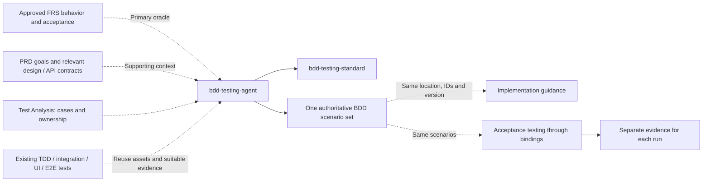
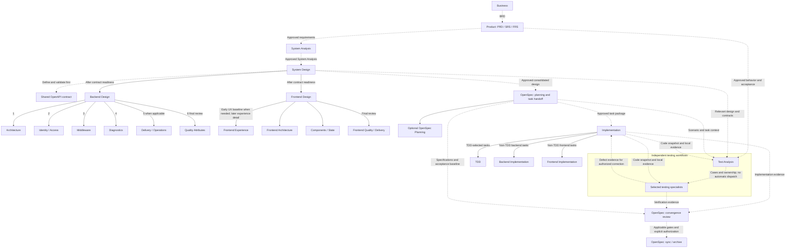

# Requirements, Design, OpenSpec, Implementation and Testing Skill Library

System Design is strictly diagrams first, supporting words second: every substantive technical section and feature handoff starts with its relevant visual, followed by concise exact rules, rationale and evidence. Main/branch coordinators and specialists enforce this at readiness; templates follow the same order. The Index opens with an authority/navigation diagram. Machine-readable contracts, SQL and administrative records retain their proper formats. Missing required views or prose-first technical sections block affected design readiness.

Reusable workflows for AI agents that create and review business, product, software-requirement, functional-requirement, system-analysis, and system-design documents, with independently invoked OpenSpec artifact management, Implementation and Testing workflows.

This library is not limited to Codex. Its core content is Markdown-based and can be used by any AI agent or runtime that can read `SKILL.md` and follow Markdown instructions. Codex-specific metadata is included where useful, but it is optional to other runtimes.

## Input and output contracts

Every workflow `SKILL.md` exposes an **Input and output contract** with required inputs, conditional inputs, optional context, outputs, destination/consumer and completion criteria. These summaries point readers to the existing detailed workflow and gates; they do not replace them or broaden authority. The PlantUML syntax reference uses a lighter context/result contract.

- Record the owning source, location/version and decision status; leave unknown ownership or approval explicit instead of inventing it.
- Required inputs apply to the requested mode and scope. Conditional inputs become required only when the stated dependency applies. Optional examples never constitute approval, and missing optional context alone does not block work.
- Block only work that depends on a missing required input. Planning may record future execution prerequisites; review may inspect retained evidence without a live target. Existing source/readiness gates and provisional/draft modes still govern.
- Outputs use the existing, requested or documented default destination. Name their consumer without automatically invoking another workflow or producing duplicate handoff documents.
- Completion means the requested scope and mode meet their existing gate. Keep design readiness, code/local checks, observed testing, approvals and release status distinct; planned or unavailable checks are not passes.

## What is included

### Skills

Skills provide reusable domain instructions, templates, quality gates, and references.

- `brd-standard` — Create or audit decision-ready Business Requirements Documents.
- `prd-standard` — Create or audit AI-ready Product Requirements Documents.
- `srs-standard` — Create or audit Software Requirements Specifications.
- `frs-standard` — Create or audit detailed Functional Requirements Specifications.
- `system-analysis-standard` — Analyze system boundaries, actors, logical flows, responsibilities, data behavior, integrations, risks, and design inputs.
- `system-design-standard` — Design architecture, components, interfaces, data, sequences, security, reliability, operations, deployment, and verification.
- `languages-engine-standard` — Choose frontend and backend languages and frameworks, database engines, and query languages or interfaces from project requirements.
- `frontend-architecture-standard` — Design frontend rendering, routing, module, server/client, dependency, composition, and failure boundaries.
- `frontend-component-design-standard` — Design component responsibilities, APIs, composition, UI states, forms, and design-system integration.
- `frontend-state-data-standard` — Design frontend state ownership, API data flow, cache, optimistic updates, URL/form/session/storage, and recovery.
- `frontend-experience-standard` — Define responsive, accessible, localized, themed, motion-aware, browser/device UI behavior.
- `frontend-performance-standard` — Define route, asset, rendering, interaction, memory, RUM, and regression budgets.
- `frontend-security-standard` — Design browser/client controls for content, sessions, storage, origins, policies, dependencies, and sensitive data.
- `frontend-observability-standard` — Define client errors, RUM, journey events, correlation, release/source-map, privacy, dashboards, and alerts.
- `frontend-build-delivery-standard` — Define reproducible frontend builds, artifacts, public configuration, caching, promotion, rollout, and rollback.
- `plantuml-syntax` — Reference PlantUML syntax and diagram types for requirements and system documentation.
- `clean-code-standard` — Write, refactor, and review maintainable code with a mandatory workflow and task-selected guidance for naming, control flow, comments, object design, patterns, and SOLID.
- `backend-layered-architecture-standard` — Design and review language-neutral layers, modules, dependency direction, ports/adapters, transaction ownership, and test seams.
- `api-design-standard` — Define shared backend/frontend OpenAPI contracts and stable service APIs, with a coordinator mode that does not invoke other skills. Renamed from `backend-api-design-standard`.
- `db-standard` — Design durable-data ownership, stores, schemas, access paths, transactions, migrations, retention, backup, and restore.
- `backend-resilience-standard` — Design bounded deadlines, retries, isolation, overload protection, degradation, health, reconciliation, and recovery.
- `deployment-release-standard` — Design immutable artifacts, promotion, rollout, feature release, migration sequencing, recovery, and release evidence.
- `testing-strategy-standard` — Design risk-based test portfolios, environments, data, automation, non-functional tests, gates, and evidence.
- `test-analysis-standard` — Derive the complete change-specific Test Case Matrix, specialist allocation, prerequisites, evidence, and independent analysis-readiness verdict.
- `unit-testing-standard` — Design and implement deterministic isolated application-logic unit tests.
- `bdd-testing-standard` — Discover and specify Given/When/Then business examples, automate or verify acceptance checks, and retain traceable evidence through seven mandatory steps.
- `integration-testing-standard` — Verify real databases, brokers, caches, services, frameworks, and other integration boundaries.
- `contract-testing-standard` — Verify provider/consumer API, event, message, schema, version, and semantic compatibility.
- `ui-testing-standard` — Verify UI rendering, interaction, visual behavior, accessibility, compatibility, and critical journeys.
- `system-e2e-testing-standard` — Verify critical multi-component journeys in a representative deployed environment.
- `security-testing-standard` — Verify approved security controls within explicit target authorization and safety limits.
- `performance-testing-standard` — Plan, implement, execute or review bounded performance/capacity experiments through seven mandatory steps, with workload validity, comparable evidence and explicit verdicts.
- `regression-testing-standard` — Select and verify risk-based regression coverage across test levels from actual change impact.
- `tdd-standard` — Implement approved behavior through traceable Red-Green-Refactor cycles.
- `software-security-standard` — Identify, design, implement, and verify risk-based software security controls across SA, SD, SDD, code, and operations.
- `authentication-standard` — Select and verify identity mechanisms, credential validation, sessions/cookies/tokens, lifecycle, revocation and failure behavior through a mandatory seven-step workflow.
- `authorization-standard` — Define and verify permission models, tenant/object/field boundaries, enforcement and policy lifecycle through a mandatory seven-step workflow.
- `exception-error-standard` — Design and review error taxonomy, throw/return/catch boundaries, translation, retries, recovery, and safe public mappings.
- `cache-standard` — Design and review cache necessity, source of truth, keys, TTL, consistency, invalidation, resilience, Redis and Memcached integration, and cache operations.
- `message-standard` — Design and review message contracts, delivery, idempotency, ordering, retry, dead letters, replay, and Kafka, RabbitMQ, RocketMQ, and Pulsar behavior.
- `log-trace-standard` — Design, implement, and troubleshoot structured logs and distributed traces, including redaction, sinks, propagation, sampling, and correlation.
- `sdd-standard` — Manage OpenSpec specifications/task artifacts, review supplied evidence for convergence, and perform authorized synchronization/archive without coding or test execution.

### Agents

Agents are focused workflows. Coordinators own lifecycle gates, routing, handoffs, conflicts, and final status; specialists load only the standards needed for one stage or design concern.

- `business-agent` — Produces BRDs with `brd-standard`.
- `product-agent` — Applies `prd-standard` → `srs-standard` → `frs-standard` directly for the requested stages and writes each document to a separate file.
- `system-analysis-agent` — Produces logical System Analysis documents with `system-analysis-standard`.
- `system-design-agent` — Defines the shared OpenAPI contract, coordinates backend/frontend branches, and assembles the final SD set. Its workflow and final gate live directly in `SKILL.md`; its only additional skill is `api-design-standard`.
  - `backend-design-agent` — Runs the mandatory eleven-step workflow, including these ordered sibling stages, and returns one consolidated backend design.
    - `architecture-agent` — Only language/engine → backend-layering → database skills; owns modules, data models, DDL/DML, transactions and migration design.
    - `identity-access-agent` — Only authentication → authorization skills; owns identity/session/token and permission/enforcement design.
    - `middleware-engineering-agent` — Only cache → message → backend-resilience skills; justifies absent capabilities and owns applicable integration/failure behavior.
    - `diagnostics-agent` — Only log/trace → exception/error skills; owns coherent troubleshooting, correlation, redaction and failure diagnostics.
    - `delivery-operations-agent` — Conditional configuration, deployment/release and operational support stage before final quality review.
    - `quality-attributes-agent` — Final cross-cutting review against the security, resilience, performance/capacity and recovery constraints supplied at intake.
  - `frontend-design-agent` — Runs a mandatory ten-step workflow with conditional early UX baseline preparation and four ordered dedicated sibling agents and returns one consolidated frontend design.
    - `frontend-architecture-agent` — Confirms the frontend stack, rendering, routes, modules and execution boundaries.
    - `frontend-component-state-agent` — Applies component design then state/data guidance; owns component contracts, forms, client state and API flow.
    - `frontend-experience-agent` — Establishes missing UX baselines with installed `ui-ux-pro-max` before dependent architecture/components; later translates accepted choices into responsive, accessible, localized and supported UI behavior using `frontend-experience-standard`.
    - `frontend-quality-delivery-agent` — Applies performance, security, observability and build/delivery guidance, then reviews the assembled client design against intake constraints.
- `middleware-engineering-agent` — Also supports direct authorized selection, integration and troubleshooting of cache/message/dependency-failure concerns under its mandatory workflow.
- `spec-driven-development-agent` — Independently owns OpenSpec artifact planning, validation, task handoffs, supplied-evidence review and authorized sync/archive. It never invokes Implementation or Testing.
  - `openspec-planning-agent` — Optional internal artifact specialist for Explore, Propose and Review.
- `implementation-agent` — Independently owns ten mandatory coding-coordination steps, including TDD selection before production coding and local verification. Accepts approved tasks from issues, requests, specifications or optional OpenSpec artifacts.
  - `tdd-agent` — Owns complete Red-Green-Refactor cycles and both production code and cycle tests.
  - `backend-implementation-agent` — Owns eight mandatory steps for authorized non-TDD backend coding and local evidence.
  - `frontend-implementation-agent` — Owns eight mandatory steps for authorized non-TDD frontend coding and local evidence.
- `test-analysis-agent` — Independently plans cases, exact expectations, coverage, execution allocation and conditional contract/E2E decisions; does not spawn execution agents.
- `unit-testing-agent` — Independently verifies isolated backend/frontend logic using only unit-testing-standard.
- `bdd-testing-agent` — Independently specifies, automates, executes or reviews business acceptance scenarios using only bdd-testing-standard; records the actual test level and preserves one execution owner.
- `integration-testing-agent` — Independently verifies logic across real boundaries using only integration-testing-standard.
- `contract-testing-agent` — Uses only contract-testing-standard for TA Required scopes or equivalent explicit standalone scope/rationale; honors supplied exclusions.
- `ui-testing-agent` — Independently verifies rendered states, interactions, visuals, accessibility and browser/device behavior using only ui-testing-standard.
- `system-e2e-testing-agent` — Uses only system-e2e-testing-standard for TA Required critical journeys or equivalent explicit standalone scope/rationale; honors supplied exclusions.
- `performance-testing-agent` — Independently verifies benchmark/load/stress/spike/soak/capacity cases using only performance-testing-standard, with explicit execution limits.
- `security-testing-agent` — Independently verifies authorized controls using only security-testing-standard.
- `regression-testing-agent` — Independently selects/assesses regression coverage and supplied results using only regression-testing-standard; it does not launch other workflows.

The user chooses each entry point; no delivery coordinator is introduced. OpenSpec, Implementation and Testing exchange approved sources, task records, test plans, code snapshots and retained evidence as data. They do not invoke each other or require another workflow's lifecycle mode. Formal OpenSpec and TA artifacts are optional inputs unless the project explicitly requires them. Missing material behavior or execution authorization still blocks dependent work.

All nine testing specialists, Test Analysis and TDD retain seven mandatory steps; backend/frontend coding retain eight and Implementation retains ten, directly in SKILL.md. Testing skills and [allocation guidance](agents/test-analysis-agent/references/specialist-coordination.md#dedicated-testing-skills) preserve one case owner, exact oracles, scope exclusions and failures. Implementation runs task-owned TDD/local checks but does not dispatch independent testing agents or claim their verdicts.

When Implementation is directly invoked at root depth 0, its coding children are depth 1. Respect actual runtime depth/shared slots instead of assuming an SDD parent. Only independent scopes with stable prerequisites and exclusive writes may run concurrently. Code-ready/local-check status, independent verification status and OpenSpec artifact/acceptance status remain separate; a combined acceptance task cannot pass with missing required evidence.

`ui-ux-pro-max` is an external skill dependency of Frontend Experience, resolved from the runtime skill catalog; it is not vendored here. Install it with its search scripts/references in environments that need visual/interaction proposal work. Existing accepted UX baselines are reused; missing skill access blocks only work requiring it. Search results remain recommendations, with accepted choices versioned and passed to downstream owners.

Agent-capable runtimes execute independent backend/frontend branches from the same validated baseline. Each branch's same-scope specialists follow its ordered pass, with accepted decisions handed forward and feedback sent to earlier owners. Only independent scopes with satisfied prerequisites may continue concurrently. Branches respect actual depth/shared concurrency limits and may apply selected profiles sequentially when they cannot spawn children. If the main System Design coordinator cannot delegate, it reports pending branch work rather than loading their technical skills. Other workflows retain their own execution rules.

Backend intake captures quality constraints before Architecture. Contract-review collects bounded architecture, identity/access and public-error feedback before `Contract-Ready`; detailed design does not begin on a draft. Later session/permission/outbox schema needs return to Architecture, and public API changes return to the main coordinator. Cache and messaging may be `Not Applicable`, while dependency resilience can still be required. Final quality review checks the initial constraints and the applicable operational evidence rather than introducing targets at the end.

### Optional Codex Custom Agent adapter

The portable `agents/` and `skills/` directories remain the only workflow source of truth. `adapters/codex/agents/*.toml` adds thin Codex-native Custom Agent definitions that invoke selected existing Agent Skills without copying their full instructions or fixing a model:

| Codex Agent | Portable Agent Skill | Intended coordinator |
|---|---|---|
| `backend_implementation` | `backend-implementation-agent` | `implementation-agent` after non-TDD selection |
| `frontend_implementation` | `frontend-implementation-agent` | `implementation-agent` after non-TDD selection |
| `backend_design` | `backend-design-agent` | `system-design-agent` |
| `architecture` | `architecture-agent` | `backend-design-agent` |
| `identity_access` | `identity-access-agent` | `backend-design-agent` |
| `middleware_engineering` | `middleware-engineering-agent` | Backend Design / implementation |
| `diagnostics` | `diagnostics-agent` | `backend-design-agent` |
| `frontend_design` | `frontend-design-agent` | `system-design-agent` |
| `frontend_architecture` | `frontend-architecture-agent` | `frontend-design-agent` |
| `frontend_component_state` | `frontend-component-state-agent` | `frontend-design-agent` |
| `frontend_experience` | `frontend-experience-agent` | `frontend-design-agent` |
| `frontend_quality_delivery` | `frontend-quality-delivery-agent` | `frontend-design-agent` |
| `quality_attributes` | `quality-attributes-agent` | `backend-design-agent` |
| `delivery_operations` | `delivery-operations-agent` | `backend-design-agent` |
| `security_testing` | `security-testing-agent` | Independent user invocation |
| `performance_testing` | `performance-testing-agent` | Independent user invocation |

To enable selected wrappers in Codex, copy their TOML files to a project's `.codex/agents/` directory or the user's `~/.codex/agents/` directory. They inherit the parent session's model, permissions, Skills, and MCP configuration unless the runtime configuration overrides them. Adapters preserve their own workflow ownership; they do not introduce cross-workflow coordination.

Testing after implementation begins by reviewing existing TDD tests and evidence. Reuse suitable tests, add coverage for gaps, and rerun affected checks when requested, required by project gates, or invalidated by changed snapshots/conditions. Retained results may be reused only with adequate provenance and scope; report reuse separately from new execution. Unit/integration testing agents are not automatically required after every TDD task.

## Independent workflow relationships



BDD is an optional approach to business acceptance, not a ninth test level or a mandatory duplicate suite. Its agent and standard each contain seven mandatory steps. The user invokes the workflow independently before coding for scenario specification or during testing for acceptance automation/verification. Record the actual execution boundary and one owner per case, retain active TDD ownership, and preserve required contract/E2E checks. Dashed arrows show supplied inputs, not automatic delegation. Production code remains with Implementation; BDD-Specified is distinct from BDD-Passed.

Approved FRS feature behavior and acceptance criteria are BDD's primary input; use explicitly identified equivalent approved criteria when no FRS exists. Specify all selected approved behavior before or after coding, and execute against the relevant implementation/environment. Retain required unimplemented cases, record approved later-increment scope separately, and return missing expectations to Product instead of deriving them from existing code.

Write and approve one authoritative BDD scenario set, then reuse its location/version and stable IDs in both implementation and testing. Scenarios define behavior, bindings/fixtures implement verification, and each run produces separate evidence. Reuse existing approved FRS scenarios or maintained feature files; handoffs and Test Analysis reference them instead of maintaining copies. Revise scenarios for approved behavior changes, clarifications or coverage gaps grounded in approved behavior, then reassess affected tests/evidence. A new phase or run does not require rewriting scenarios.

The normal OpenSpec-based delivery sequence is requirements and analysis, System Design, OpenSpec planning/task handoff, Implementation, independent testing, then OpenSpec convergence review. Independence describes who invokes and owns each workflow; it does not remove the order of their artifact dependencies. The user invokes each stage when its inputs are ready. In the diagram, solid arrows show delegation; dashed arrows show supplied artifacts/evidence. Testing is a grouping of independently invoked workflows, not a coordinator agent.



Backend detailed stages follow the numbered order, with Delivery/Operations conditional. Frontend establishes a missing UX baseline before Architecture and Components/State, then performs detailed Experience work and final Quality/Delivery review. Both branches work from the same accepted contract and the main coordinator consolidates their results before the approved design handoff. Bounded branch contract-review feedback precedes contract readiness; the diagram's branch arrows describe detailed design.

OpenSpec planning/handoff, convergence and sync/archive are modes of the same agent, not three coordinators. For the normal sequence, pass its approved task package to Implementation rather than deriving a competing task plan directly from System Design. Implementation selects TDD or justified non-TDD routes per task. Test Analysis may plan cases before coding and later review actual impact/coverage; independent execution follows when the relevant implementation/environment is available. BDD uses the shared FRS-derived scenario set described above, without creating separate implementation/testing copies.

Example user invocations: ask OpenSpec to prepare and validate the task package from approved design; ask Implementation to implement that package; independently ask Test Analysis to assess coverage and selected testing specialists to verify the snapshot; then ask OpenSpec to review supplied evidence for convergence and sync/archive when authorized. Suitable existing TDD/tests/evidence are reused under their validity rules. Standalone coding or testing from equivalent approved inputs remains supported when OpenSpec is not being used; it is an alternative entry path, not the primary sequence shown here. Required behavior, authorization and acceptance evidence cannot be silently skipped.

The default outputs are separate documents because each artifact has a different audience, purpose, change cadence, and approval gate:

```text
output/BRD/BRD-<project-name>.md
output/PRD/PRD-<project-name>.md
output/SRS/SRS-<project-name>.md
output/FRS/FRS-<project-name>.md
output/SA/SA-<project-name>.md
output/SA/diagrams/                            # maintained logical PlantUML sources and optional rendered previews
output/SD/SD-<project-name>-index.md
output/SD/SD-<project-name>-backend.md       # when backend scope exists
output/SD/SD-<project-name>-frontend.md      # when frontend scope exists
output/SD/SD-<project-name>-integration.md   # when a cross-boundary contract exists
output/SD/diagrams/                           # maintained technical PlantUML sources and optional rendered previews
output/SD/contracts/                          # only applicable machine-readable contracts
output/SD/database/                           # applicable physical model, proposed DDL/DML, access-path, transaction, and migration design

openspec/changes/<change-name>/              # only when using OpenSpec; active schema determines files
├── proposal.md
├── specs/<capability>/spec.md
├── design.md
├── tasks.md
└── verification.md                         # optional supplied-evidence review

evidence/<scope>/                            # example; use the project's user-selected location
├── test-analysis.md                         # when analysis is requested
├── implementation-evidence.md               # optional coding/local-check handoff
├── contract-test-report.md                  # only when requested/applicable
├── ui-test-report.md
├── system-e2e-test-report.md
├── performance-test-report.md
├── security-test-report.md
└── regression-test-report.md                # only when regression is requested

```

Traceability connects approved requirement/scenario -> optional specification/task/TA IDs -> code snapshot -> observed evidence. OpenSpec records need not exist for a direct coding or testing request; test plans/results can live outside OpenSpec. These references do not grant permission to invoke another workflow.

## Portable structure

```text
agents/
├── architecture-agent/
├── backend-design-agent/
├── backend-implementation-agent/
├── bdd-testing-agent/
├── business-agent/
├── contract-testing-agent/
├── delivery-operations-agent/
├── diagnostics-agent/
├── frontend-architecture-agent/
├── frontend-component-state-agent/
├── frontend-experience-agent/
├── frontend-quality-delivery-agent/
├── frontend-design-agent/
├── frontend-implementation-agent/
├── identity-access-agent/
├── implementation-agent/
├── integration-testing-agent/
├── middleware-engineering-agent/
├── openspec-planning-agent/
├── performance-testing-agent/
├── product-agent/
├── quality-attributes-agent/
├── regression-testing-agent/
├── security-testing-agent/
├── system-analysis-agent/
├── system-design-agent/
├── system-e2e-testing-agent/
├── spec-driven-development-agent/
├── tdd-agent/
├── test-analysis-agent/
├── ui-testing-agent/
└── unit-testing-agent/

skills/
├── api-design-standard/
├── authentication-standard/
├── authorization-standard/
├── bdd-testing-standard/
├── brd-standard/
├── cache-standard/
├── clean-code-standard/
├── contract-testing-standard/
├── db-standard/
├── deployment-release-standard/
├── exception-error-standard/
├── frontend-architecture-standard/
├── frontend-build-delivery-standard/
├── frontend-component-design-standard/
├── frontend-experience-standard/
├── frontend-observability-standard/
├── frontend-performance-standard/
├── frontend-security-standard/
├── frontend-state-data-standard/
├── frs-standard/
├── integration-testing-standard/
├── languages-engine-standard/
├── backend-layered-architecture-standard/
├── log-trace-standard/
├── message-standard/
├── performance-testing-standard/
├── plantuml-syntax/
├── prd-standard/
├── regression-testing-standard/
├── backend-resilience-standard/
├── sdd-standard/
├── security-testing-standard/
├── software-security-standard/
├── srs-standard/
├── system-analysis-standard/
├── system-design-standard/
├── system-e2e-testing-standard/
├── tdd-standard/
├── test-analysis-standard/
├── testing-strategy-standard/
├── unit-testing-standard/
└── ui-testing-standard/

adapters/
└── codex/
    └── agents/
        ├── architecture.toml
        ├── backend_design.toml
        ├── backend_implementation.toml
        ├── delivery_operations.toml
        ├── diagnostics.toml
        ├── frontend_architecture.toml
        ├── frontend_component_state.toml
        ├── frontend_experience.toml
        ├── frontend_quality_delivery.toml
        ├── frontend_design.toml
        ├── frontend_implementation.toml
        ├── identity_access.toml
        ├── middleware_engineering.toml
        ├── performance_testing.toml
        ├── quality_attributes.toml
        └── security_testing.toml
```

Each Skill contains a required `SKILL.md` plus optional references and metadata:

```text
<skill-name>/
├── SKILL.md
├── references/
└── agents/openai.yaml
```

Each Agent contains a discoverable `SKILL.md` and an `AGENTS.md` entrypoint. The System Design, Backend Design and Frontend Design coordinators and the Architecture, Identity/Access, Middleware, Diagnostics and four dedicated frontend specialists, plus the OpenSpec agent, Implementation, Backend Implementation, Frontend Implementation, Test Analysis, TDD and all nine testing specialists, keep their authoritative workflows directly in `SKILL.md`; their `AGENTS.md` files are compatibility pointers. Other agents retain their existing `AGENTS.md` workflow:

```text
<agent-name>/
├── AGENTS.md
├── SKILL.md
└── agents/openai.yaml
```

## Using the library

### Any AI agent or runtime

1. Read the relevant `skills/<skill-name>/SKILL.md`.
2. Read the linked references only when the current task needs them.
3. For an Agent workflow, read its `SKILL.md` and follow its declared authority. System Design coordination stays in its own entrypoint and invokes only `api-design-standard`; branch agents independently select their technical skills.
4. Preserve `Confirmed`, `Proposed`, `Assumption`, `TBC`, `Pending Approval`, `Open`, and `Deferred` statuses.
5. Do not claim approval or implementation readiness while material decisions, dependencies, acceptance criteria, or sign-offs remain unresolved.

### Codex and other compatible runtimes

`agents/openai.yaml` provides optional UI metadata for runtimes that support it. Runtimes that do not use this metadata can ignore the file and use the Markdown instructions directly.

The core workflows do not require a specific model, framework, programming language, vendor, or deployment platform.

`sdd-standard` uses the OpenSpec CLI and the active project schema as the authority for change artifacts, templates, paths, status, and archive behavior. Its readiness and convergence gates add lifecycle controls around OpenSpec without replacing upstream BRD, PRD, SRS/FRS, SA, or SD sources.

## Diagram policy

Use `plantuml-syntax` when a diagram materially improves understanding. System Analysis and System Design are Diagram-first for boundaries, relationships, flows, states, data ownership, and deployment; text remains authoritative for rules, constraints, exceptions, decisions, acceptance criteria, and unresolved items.

Every diagram should have a title, scope, explanation, source traceability, and required legend or assumptions.

## Design principles

- Keep business, product, functional, logical-analysis, and technical-design concerns separate.
- Make mandatory, conditional, and optional inputs explicit.
- Resolve or visibly record unresolved decisions; do not silently invent answers.
- Keep requirements and design artifacts testable and traceable.
- Apply object-oriented design, SOLID, and design patterns conditionally according to the selected language, paradigm, problem, and lifecycle stage.
- Use `clean-code-standard` for implementation, refactoring, and focused object or module design. Load only the references needed for the task.
- Make layer/dependency, error, caching, and messaging behavior explicit at SD level and concrete/testable at SDD level; do not introduce infrastructure without a requirement.
- For frontend scope, establish domain/data/transaction/security ownership and let the main coordinator define the shared OpenAPI contract. Obtain both applicable branch reviews, record a versioned `Contract-Ready` interface, then run backend/frontend branch design in parallel. Production implementation remains in the authorized SDD lifecycle.
- Keep authoritative business rules and authorization on the server; frontend architecture, components, state/data, experience, performance, security, observability, and delivery map approved outcomes without creating a competing source of truth.
- Treat software security as a lifecycle concern: identify assets, threats, trust boundaries, and security requirements in SA; design owned controls in SD; make them concrete and verifiable in SDD and implementation.
- Treat logging and tracing as intentional observability contracts, and comments as maintained explanations of non-obvious intent—not as automatic code volume.
- Make SA and SD visual-first: cover the system main flow plus every in-scope feature with a dedicated target logic diagram; show evidence-based current logic and problem points for brownfield changes, and add conditional state/data/integration/middleware views. Keep prose concise and normative rather than narrating diagrams.
- Prefer small authoritative documents over unnecessary detail or duplicated content. Machine-readable contracts own field/protocol structure; database artifacts own affected physical models and proposed DDL/DML; Integration SD owns cross-boundary semantics; Backend and Frontend SD own their respective internals; the Index owns coverage, status, and readiness.
- Use transient compact parent/child handoffs containing the source/contract baseline, assigned coverage, accepted design content, contract changes, dependencies/impacts, blockers and verification. Branches consolidate their specialists before returning to the main coordinator. Do not persist full specialist packets, repeated source summaries, internal reasoning or rejected-option histories by default.
- Keep at most one temporary SD coordination file, `open-decisions.md`, for unresolved material cross-document decisions; record the final review verdict and routing/status table in the Index.
